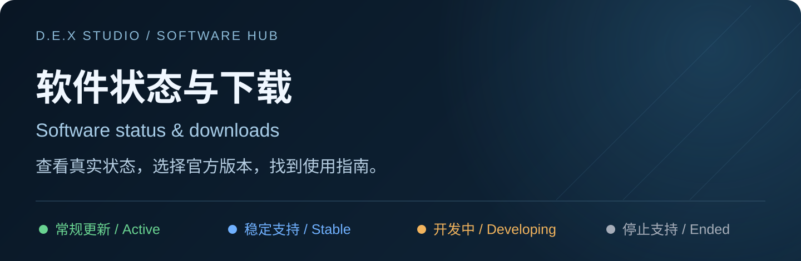
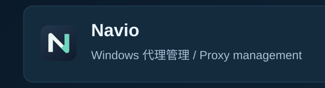
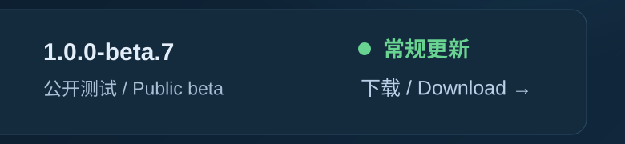
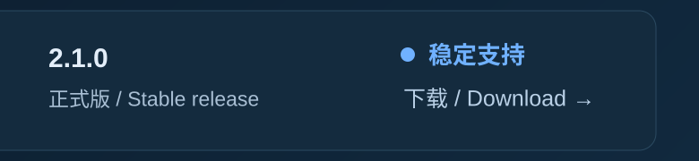
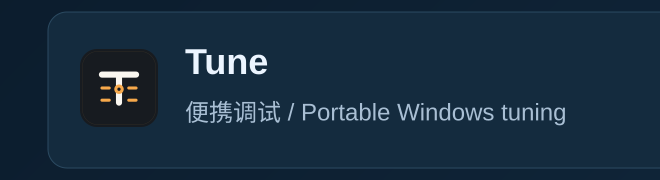
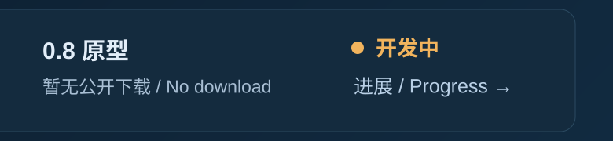
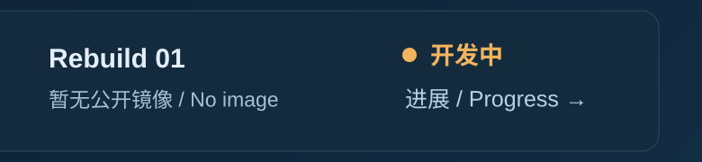
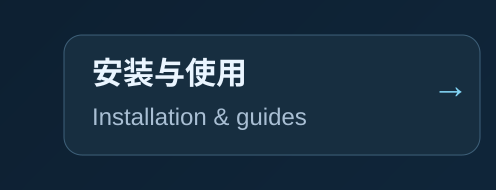
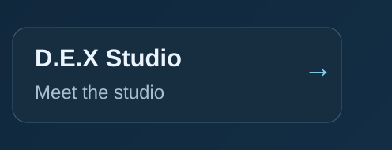

<strong>安装与使用 / Install & use</strong>

| 软件 / Software | 官方下载 / Download | 使用指南 / Guide |
| :--- | :--- | :--- |
| Navio · Windows x64 | [安装版 / Installer](https://github.com/dex-ovo-studio/Navio/releases/download/v1.0.0-beta.7/Navio-v1.0.0-beta.7-Windows-x64-setup.exe) · [免安装版 / ZIP](https://github.com/dex-ovo-studio/Navio/releases/download/v1.0.0-beta.7/Navio-v1.0.0-beta.7-Windows-x64-portable.zip) | [安装、配置与排障](https://github.com/dex-ovo-studio/Navio/blob/main/docs/guide.md) |
| Mystery · Windows x64 | [安装版 / Installer](https://github.com/dex-ovo-studio/DEX-Studio-Software-Status/releases/download/mystery-v2.1.0/DEX-Setup-2.1.0-x64.exe) | [安装与升级](https://github.com/dex-ovo-studio/Mystery/blob/main/docs/guide.md) |

升级前备份需要保留的资料，并退出正在运行的软件。Tune 与 Rovelio 尚未公开发行。  
Back up your data and quit the app before upgrading. Tune and Rovelio have no public release yet.

> **Navio Beta 7：** 部分断开场景下系统代理可能未恢复。使用前请阅读[已知问题](https://github.com/dex-ovo-studio/Navio#版本与下载--releases--downloads)。  
> System proxy restoration may fail after disconnecting; read the known issue before use.

Mystery 安装说明与文件校验 / Installation & verification

从 [2.1.0 版本页](https://github.com/dex-ovo-studio/DEX-Studio-Software-Status/releases/tag/mystery-v2.1.0) 下载 `DEX-Setup-2.1.0-x64.exe`，退出旧版后按安装向导操作。完整步骤与可选文件校验见[使用指南](https://github.com/dex-ovo-studio/Mystery/blob/main/docs/guide.md)。

Download the versioned Windows installer, close the existing app and follow setup. See the user guide for optional file verification.

<strong>历史版本 / Release history</strong>

[Navio 发行归档 / Navio releases](https://github.com/dex-ovo-studio/Navio/releases) · [Mystery 发行归档 / Mystery releases](https://github.com/dex-ovo-studio/DEX-Studio-Software-Status/releases)

Mystery 已发布版本 / Published Mystery releases

| 版本 / Version | 下载 / Download |
| :--- | :--- |
| **2.1.0 · 当前版本 / Current** | [版本页 / Release](https://github.com/dex-ovo-studio/DEX-Studio-Software-Status/releases/tag/mystery-v2.1.0) |
| 2.0.0 | [版本页 / Release](https://github.com/dex-ovo-studio/DEX-Studio-Software-Status/releases/tag/mystery-v2.0.0) |
| 1.2.0 | [版本页 / Release](https://github.com/dex-ovo-studio/DEX-Studio-Software-Status/releases/tag/mystery-v1.2.0) |
| 1.1.0 | [版本页 / Release](https://github.com/dex-ovo-studio/DEX-Studio-Software-Status/releases/tag/mystery-v1.1.0) |
| 1.0.0 | [版本页 / Release](https://github.com/dex-ovo-studio/DEX-Studio-Software-Status/releases/tag/mystery-v1.0.0) |
| 0.2.0 | [版本页 / Release](https://github.com/dex-ovo-studio/DEX-Studio-Software-Status/releases/tag/mystery-v0.2.0) |

旧版保留供回溯，不保证兼容当前账号服务。日常使用建议选择 2.1.0。  
Archived releases may not support current account services. Use 2.1.0 for everyday use.

彩色状态说明 / Status legend

- 🟢 **常规更新 / Active**：常规版本更新与维护。
- 🔵 **稳定支持 / Stable support**：保留维护与反馈渠道，暂不安排常规功能更新。
- 🟠 **开发中 / In development**：原型完善中，尚无公开发行包。
- ⚪ **停止支持 / Ended**：停止版本维护，以项目公告为准。

Tune 进展记录：2026-11-11；Rovelio 进展记录：2026-09-06。详细完成情况见各自状态页。  
Progress records: Tune 2026-11-11; Rovelio 2026-09-06. See each project's status page for details.

<strong>支持与反馈 / Support & feedback</strong>

[Navio 使用反馈](https://github.com/dex-ovo-studio/Navio/issues) · [Mystery 官网反馈](https://mystery.mydex.top) · [下载与状态纠错](https://github.com/dex-ovo-studio/DEX-Studio-Software-Status/issues)

反馈时提供软件版本、系统版本、复现步骤与错误提示。  
Include the app version, operating system, steps to reproduce and error message.

[返回 D.E.X Studio / Back to Studio](https://github.com/dex-ovo-studio)
